<div align="center">



<br/>

[](https://portofolio-ayudya.vercel.app/)
[](mailto:gustiayudyakusumawardani@gmail.com)

</div>

<br/>

### `// about`

I like knowing **how things work**: how an app is built, how data is shaped, how AI learns.
Then I try to build my own version. Usually I start from the database, then the backend, then I can't stop until the UI looks right too.

```js
const ayudya = {
  role: "Full-stack Web Developer",
  base: "Tangerang, Indonesia",
  studying: "Information Systems @ Universitas Pamulang",

  stack: {
    web:      ["Laravel", "Next.js", "React", "Node.js", "TypeScript", "PHP"],
    mobile:   ["Flutter"],
    data:     ["PostgreSQL", "MySQL", "SQLite", "Python (Pandas, Matplotlib)"],
    cloud:    ["Cloudflare Workers", "D1", "R2"],
    design:   ["Figma", "Photoshop", "Illustrator"],
  },

  currentlyLearning: ["Cloudflare Workers + D1", "AI & machine learning"],
  offTheKeyboard:    "Paskibraka. Discipline first, then deadlines.",
};
```

<br/>

### `// how I work`

- 🗄️ **Data first:** schema, relations, and queries get designed before any button gets drawn
- 🧩 **Ship in small pieces:** deliver step by step, then adjust from real feedback
- 🧼 **Clean for non-techies:** interfaces that staff can use without a manual

<br/>

<div align="center">

<sub>built with curiosity, coffee, and too many browser tabs</sub>

</div>
